# Assignment 9: Observability with OpenTelemetry

**Name:** 陳致安 · **Student ID:** B11309058 · **Course:** DevOps · **Date:** November 3, 2026
**Code:** <https://github.com/wagyboy/devops-otel-lab>
**Stack:** Python 3.10 / 3.12 · OpenTelemetry SDK 1.45.2 (instrumentation 0.66b2) · Docker Desktop 29.9.2 · OTel Collector Contrib 0.164.0 · Jaeger 2.22.0 · Prometheus 3.15.1

| Level | What I built | Section |
| --- | --- | --- |
| A | SDK with a console exporter; a 7-span trace with nesting, attributes, events and an error | 2 |
| E | Dockerized Collector: OTLP on 4317 → memory_limiter, resource, batch → console + local file, for traces **and** logs | 3 |
| O (feature 1) | Flask instrumentation of two services, W3C context propagation across HTTP, and baggage | 4.1 |
| O (feature 2) | Collector with three pipelines plus a spanmetrics connector, Prometheus metrics, and log ↔ trace correlation | 4.2 |

## 1. Introduction: why observability matters in DevOps

DevOps ships small changes often, so the team needs to find out quickly whether a change made production worse. Monitoring answers questions you asked in advance ("is CPU above 80 %?"). Observability lets you ask new questions afterwards ("why are only premium checkouts slow since 14:05?"), because the system emits rich telemetry:

- **Traces** show the path of one request through every service, with timing for each step.
- **Metrics** are cheap numeric time series (rates, errors, latency) used for dashboards and alerts.
- **Logs** are detailed event records. They become far more useful when each line carries the trace ID of the request that produced it.

OpenTelemetry (OTel) is the vendor-neutral CNCF standard for producing these three signals. The application is instrumented once with the OTel API and SDK and sends data with OTLP. Where the data ends up (Jaeger, Prometheus, a file, a SaaS vendor) is decided in the **Collector** configuration, not in application code. This assignment builds that path step by step.

The key code and configuration are excerpted in each section; the full source (folders `task1/`, `task2/`, `o-level/`) is at <https://github.com/wagyboy/devops-otel-lab>. Every screenshot is real output from the runs on November 3, 2026.

## 2. Task 1 (A): OpenTelemetry SDK with console output

**Setup.** I created a virtual environment and installed `opentelemetry-sdk`. The demo `task1/console_demo.py` simulates a checkout and has four parts:

1. a `TracerProvider` with a **resource** (`service.name`, `service.version`, `deployment.environment`)
2. a `ConsoleSpanExporter` wrapped in a `SimpleSpanProcessor`
3. a tracer
4. nested spans built with `start_as_current_span`

```python
provider = TracerProvider(resource=Resource.create({"service.name": "checkout-demo", ...}))
provider.add_span_processor(SimpleSpanProcessor(ConsoleSpanExporter()))
trace.set_tracer_provider(provider)
tracer = trace.get_tracer("a9.checkout")

with tracer.start_as_current_span("checkout") as root:          # root span
    root.set_attribute("order.id", order_id)
    with tracer.start_as_current_span("reserve-stock"):         # child
        for sku in range(items):
            with tracer.start_as_current_span("db.update-stock"): ...   # grandchildren
    with tracer.start_as_current_span("charge-payment") as pay:
        pay.add_event("first attempt timed out", {"retry.after_ms": 20})
    with tracer.start_as_current_span("send-email") as mail:     # fails on purpose
        mail.record_exception(exc); mail.set_status(Status(StatusCode.ERROR, str(exc)))
```

To make the hierarchy easy to read, I also passed a one-line `formatter` to the exporter (`--compact`, Figure 1). Figure 2 shows the default JSON output.

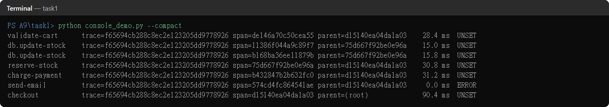

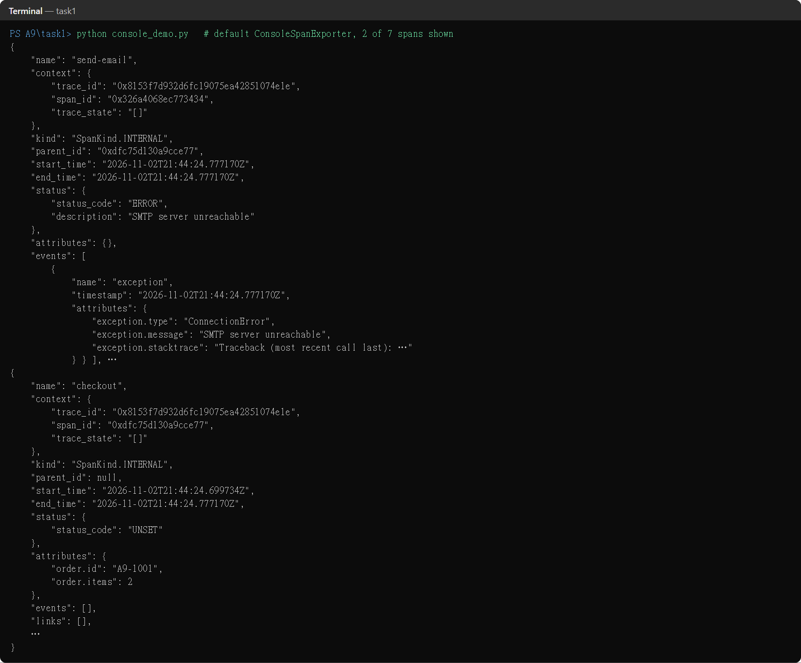

**Reading the output.** All seven spans carry the same `trace_id` (`f65694cb…`). `checkout` is the root (`parent=(root)`, or `parent_id: null` in JSON). `validate-cart`, `reserve-stock`, `charge-payment` and `send-email` point to the root's span ID. The two `db.update-stock` spans point to `reserve-stock`. This gives the tree:

`checkout` → { `validate-cart`, `reserve-stock` → { `db.update-stock` ×2 }, `charge-payment`, `send-email` (ERROR) }

**What is a trace?** A trace is the record of one operation (here one checkout) as it moves through a system. It is a tree of **spans**. Each span is one unit of work with a name, start and end time, attributes, events and a status. The **trace context** (trace ID, span ID, flags) links them: every span in the trace shares the trace ID and stores its parent's span ID. Inside one process, the SDK keeps the current span in a context variable, which is how `start_as_current_span` knows the parent. Across processes, the context is carried in headers (Section 4.1).

**What role does the exporter play?** Instrumentation only *creates* spans. The exporter decides *where they go* and in which format. The span processor sits between the two:

- `SimpleSpanProcessor` exports each span the moment it ends, which suits a demo.
- `BatchSpanProcessor` buffers spans and exports them in the background, which is what production uses.

Swapping the `ConsoleSpanExporter` for an `OTLPSpanExporter` (Task 2) changes the destination without touching any instrumentation code. This separation is the core idea of OpenTelemetry.

## 3. Task 2 (E): Dockerized OpenTelemetry Collector over OTLP

**Install and run.** I installed Docker Desktop (WSL 2 backend) and ran the official image `otel/opentelemetry-collector-contrib:0.164.0` from Docker Hub. I chose the *contrib* distribution because the `file` exporter is not included in the core image. `task2/docker-compose.yml` mounts the config read-only, mounts `./output` for the exported file, and publishes 4317 (OTLP gRPC), 4318 (OTLP HTTP) and 13133 (health check).

```yaml
# task2/otel-collector-config.yaml
receivers:
  otlp:
    protocols:
      grpc: { endpoint: 0.0.0.0:4317 }
      http: { endpoint: 0.0.0.0:4318 }
processors:
  memory_limiter: { check_interval: 1s, limit_mib: 256 }
  resource:
    attributes: [ { key: collector.name, value: a9-collector, action: upsert } ]
  batch: { timeout: 2s, send_batch_size: 256 }
exporters:
  debug: { verbosity: detailed }          # to the container log
  file:  { path: /output/telemetry.jsonl } # to the host through the volume
service:
  pipelines:
    traces: { receivers: [otlp], processors: [memory_limiter, resource, batch], exporters: [debug, file] }
    logs:   { receivers: [otlp], processors: [memory_limiter, resource, batch], exporters: [debug, file] }
```

**The app.** `task2/send_telemetry.py` is the same checkout flow with two changes:

- The exporter is now `OTLPSpanExporter(endpoint="http://localhost:4317")` behind a `BatchSpanProcessor`.
- Python `logging` is bridged to OTel with a `LoggerProvider` + `LoggingHandler` + `OTLPLogExporter`, so log records travel to the Collector too.

The script calls `shutdown()` on both providers before exiting. Otherwise the batch processors could drop the last records.

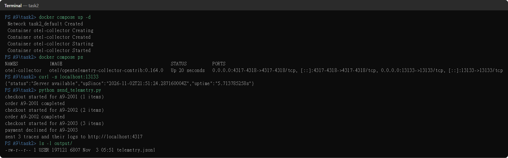

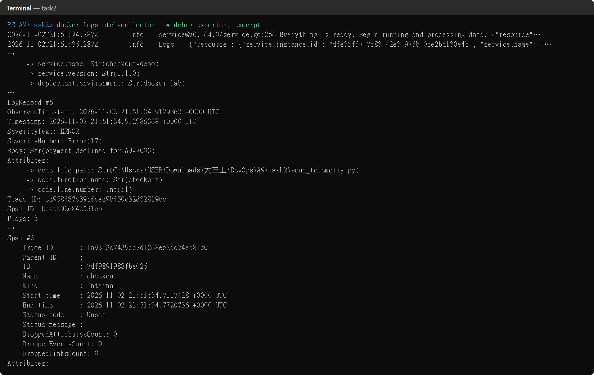

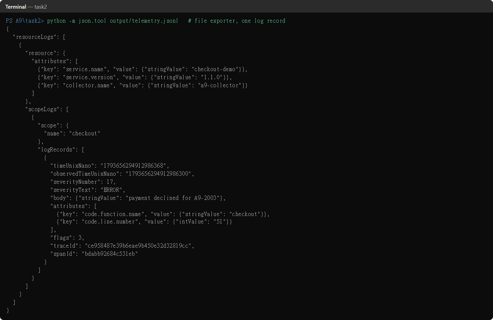

**Data flow confirmed.** app → OTLP/gRPC :4317 → Collector → `docker logs` (Figure 4) and `output/telemetry.jsonl` (Figure 5). The file holds 2 lines: one `resourceLogs` batch with 6 log records and one `resourceSpans` batch with 9 spans (3 traces × 3 spans).

| Stage | Component | What it does here | Why it matters |
| --- | --- | --- | --- |
| Receiver | `otlp` | Listens on 4317 (gRPC) and 4318 (HTTP) and decodes OTLP into the Collector's internal format | One open standard for every language SDK; the app needs no vendor library |
| Processor 1 | `memory_limiter` | Refuses new data when memory nears 256 MiB, so the sender retries | Back-pressure instead of an out-of-memory crash; must come first |
| Processor 2 | `resource` | Upserts `collector.name=a9-collector` on every record | Central enrichment (environment, cluster, region) without redeploying apps |
| Processor 3 | `batch` | Groups records for up to 2 s or 256 items | Fewer, larger export calls; must come last before export |
| Exporter | `debug` / `file` | Prints to the container log / writes JSON lines to the mounted folder | Shows that one pipeline can fan out to several destinations |
| Pipeline | `traces`, `logs` | Wires receivers → processors → exporters per signal | Each signal can be routed and processed differently (used in 4.2) |

## 4. Task 3 (O): two advanced features

I built one small system and used it to demonstrate two features. `o-level/docker-compose.yml` runs 5 containers:

- **shop-frontend** (Flask, :8080): the public API
- **inventory-service** (Flask, :8081): only called by the frontend
- **otel-collector**
- **jaeger**: trace storage and UI
- **prometheus**: metrics storage and UI

Both Python services share `telemetry.py`, which sets up traces, metrics and logs over OTLP. The endpoint and service name come from the standard environment variables `OTEL_EXPORTER_OTLP_ENDPOINT` and `OTEL_SERVICE_NAME`. `load.py` sends mixed traffic, including two kinds of expected failures:

- an unknown SKU, which returns 404
- an SKU that runs out of stock, which returns 409

A random 8 % of payments are also declined (402).

```text
load.py --HTTP--> shop-frontend --HTTP (traceparent + baggage)--> inventory-service
                       |                                                  |
                       +----------- OTLP: traces, metrics, logs ----------+
                                               v
                                         otel-collector
   traces -> Jaeger :16686  |  metrics -> :8889 <- Prometheus :9090  |  logs -> output/logs.jsonl
```

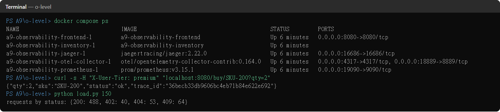

### 4.1 Feature 1: web framework instrumentation, context propagation across services, and baggage

**Setup.** No span code is written for HTTP:

- `FlaskInstrumentor().instrument_app(app)` creates a SERVER span for every request, named after the route (`GET /buy/<sku>`), with the HTTP method, route, status code and client address.
- `RequestsInstrumentor().instrument()` creates a CLIENT span for every outgoing call. It also **injects** the W3C `traceparent` header (`00-<trace-id>-<span-id>-01`) and the `baggage` header.
- On the inventory side, the Flask instrumentation **extracts** those headers, so the new SERVER span becomes a child of the frontend's CLIENT span in the same trace.

My own code adds only the business spans (`db.reserve-stock`, `charge-payment`) and the baggage:

```python
# frontend.py: put the customer tier in the context; it travels downstream with the request
token = context.attach(baggage.set_baggage("user.tier", request.headers.get("X-User-Tier", "free")))
resp = requests.get(f"{INVENTORY_URL}/reserve/{sku}", params={"qty": qty})   # traceparent + baggage injected

# inventory.py: a different process, which never saw the X-User-Tier header
tier = baggage.get_baggage("user.tier")
trace.get_current_span().set_attribute("user.tier", tier)
```

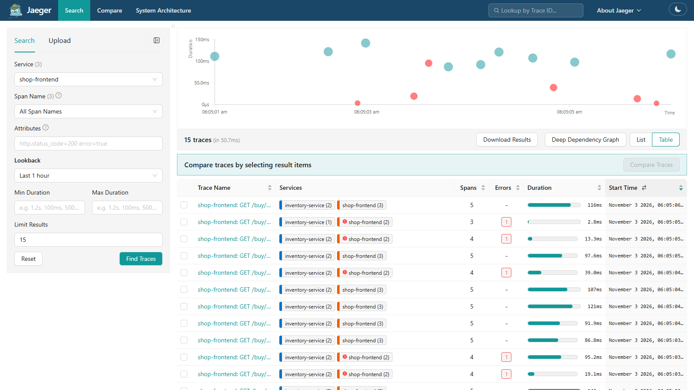

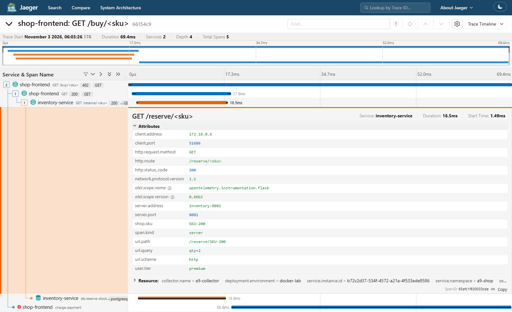

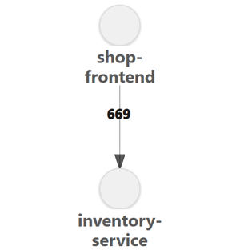

**Insight.** Without propagation, Jaeger would show two unrelated traces, one per service, and the 16.5 ms spent in inventory could not be tied to the purchase that caused it. With propagation, one request gives one tree (Figure 8). The service map in Figure 9 also comes for free: nobody had to draw it, and it stays correct when the architecture changes.

Baggage goes one step further. Business context set at the edge (`user.tier`) is readable by every downstream service, even though inventory never received the `X-User-Tier` header. Section 4.2 shows why that matters: the tier becomes a dimension on metrics.

Baggage is sent in plain text on every hop, so it must never hold secrets or personal data. A tier label is fine; a user's email is not.

### 4.2 Feature 2: Collector with multiple pipelines, Prometheus metrics, and log ↔ trace correlation

**Setup.** The Collector config defines **three pipelines**, one per signal, each with its own destination. A **connector** links two of them:

- `spanmetrics` is an *exporter* of the traces pipeline and a *receiver* of the metrics pipeline.
- It turns every span into request-count, error-count and latency-histogram metrics (the RED metrics).
- `user.tier` and `http.response.status_code` are configured as extra metric dimensions.

```yaml
connectors:
  spanmetrics:
    histogram: { explicit: { buckets: [5ms, 10ms, 25ms, 50ms, 100ms, 250ms, 500ms, 1s] } }
    dimensions: [ { name: http.response.status_code }, { name: user.tier } ]
exporters:
  otlp/jaeger: { endpoint: jaeger:4317, tls: { insecure: true } }
  prometheus:  { endpoint: 0.0.0.0:8889, resource_to_telemetry_conversion: { enabled: true } }
  file/logs:   { path: /output/logs.jsonl }
service:
  pipelines:
    traces:  { receivers: [otlp],              processors: [memory_limiter, resource, batch], exporters: [otlp/jaeger, spanmetrics] }
    metrics: { receivers: [otlp, spanmetrics], processors: [memory_limiter, resource, batch], exporters: [prometheus] }
    logs:    { receivers: [otlp],              processors: [memory_limiter, resource, batch], exporters: [file/logs, debug] }
```

The services also send their own metrics:

- automatic HTTP metrics from the instrumentations (`http.server.request.duration`, `http.client.request.duration`)
- a counter `shop.orders{result}`
- an observable gauge `inventory.stock.level{sku}`

Prometheus scrapes the Collector every 5 s (Figure 10).

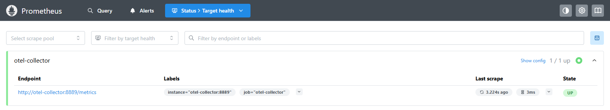

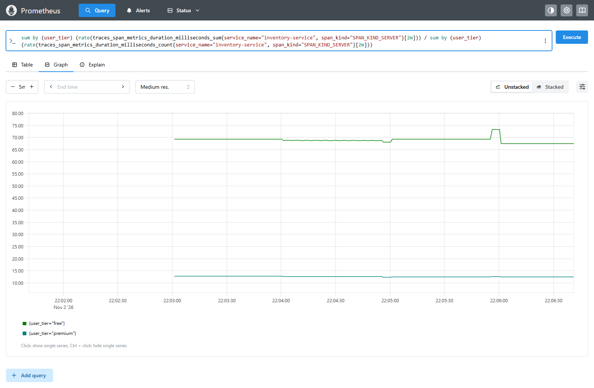

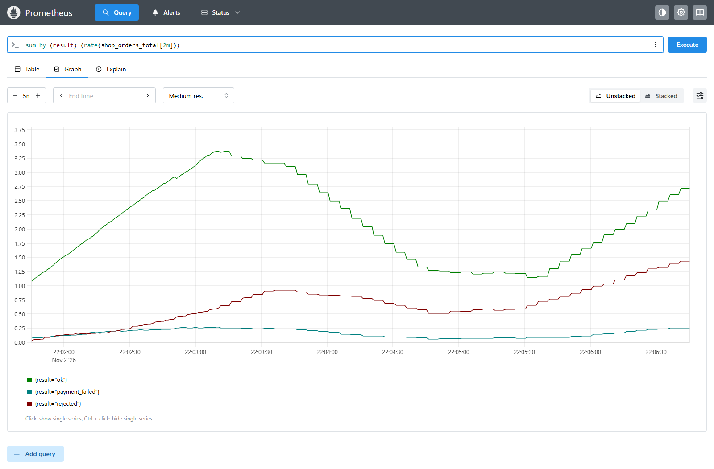

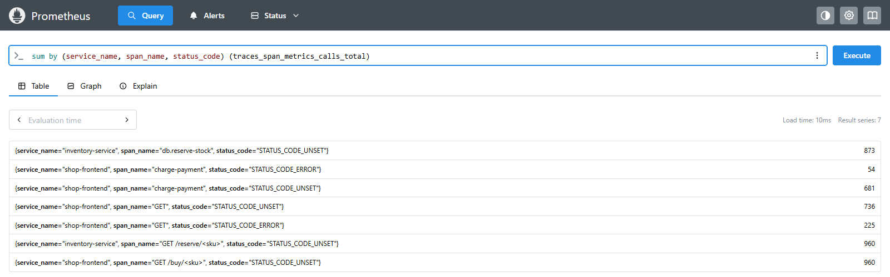

**Log ↔ trace correlation.** Every log record is written while a span is active, so the logging bridge stores `traceId` and `spanId` in the OTLP log record. `LoggingInstrumentor` also adds `trace_id=… span_id=…` to the console log format. `o-level/correlate.py` reads `output/logs.jsonl`:

- `--errors` lists the trace ID of every WARN or ERROR log.
- Given a trace ID, it prints that request's logs from **all** services, in order.

The same ID opens the trace in Jaeger (Figures 8 and 15).

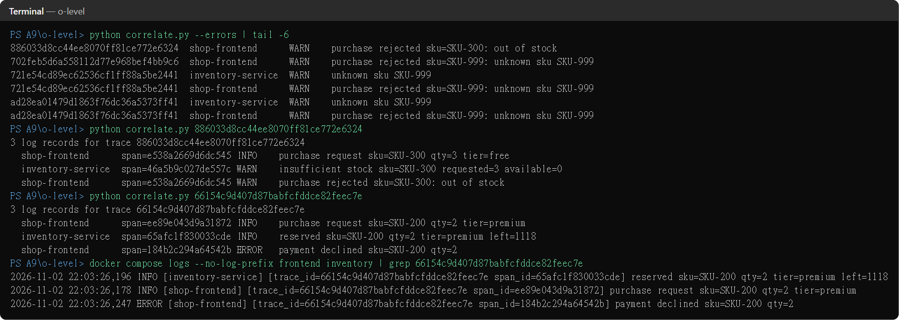

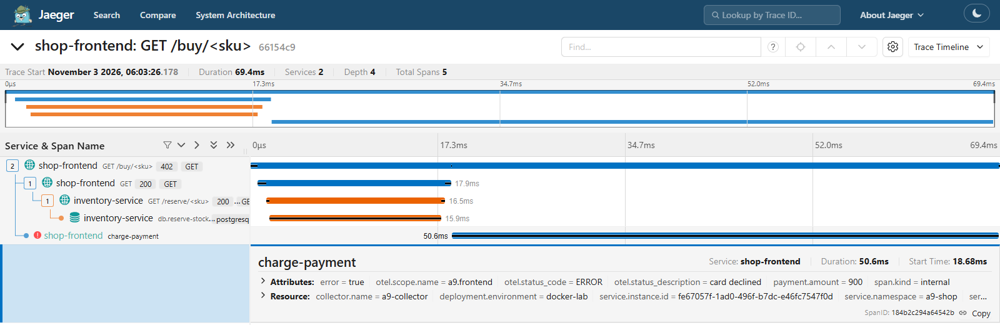

**Insight.**

- **Why separate pipelines.** Each signal needs a different backend and treatment: traces go to a trace store, metrics to a time-series database that alerting can query, and logs to cheap storage. One Collector routes all three. Changing a backend means editing YAML, not the apps.
- **Metrics from traces.** The connector produced RED metrics *from traces*, so a dashboard and an alert exist even for code with no hand-written metrics. With baggage they reveal the real finding: free users wait about 5–6 times longer in inventory (about 68 ms vs 12 ms, Figure 11).
- **The investigation loop.** A metric shows *that* something is wrong. The trace shows *where*: here, the charge-payment span is the error. The logs show *why* ("payment declined sku=SKU-200 qty=2"). The trace ID links all three.

### 4.3 Real-world relevance in DevOps pipelines

| Practice | How it uses what I built |
| --- | --- |
| Incident response (lower MTTR) | Alert on the spanmetrics error rate → open an example trace → read its logs by trace ID. No grepping across services. |
| Safe releases (A7 connection) | The canary/gate idea from A7 can use real signals: compare the new version's spanmetrics error rate and latency (`service.version` label) with the old one before promoting. |
| SLOs per customer segment | Baggage attributes such as tier or region become metric labels, so "99 % of premium checkouts under 100 ms" is measurable. |
| Vendor neutrality and cost | Apps only speak OTLP. The Collector can add sampling, drop noisy attributes or switch vendors centrally. |

## 5. Lessons learned and challenges

1. **Windows reserved ports.** `docker compose up` failed with "bind: access forbidden" on 8889, and later on 9090. Hyper-V/WSL reserve dynamic port ranges (`netsh interface ipv4 show excludedportrange`). I mapped the host ports to 18889 and 19090. The container ports and the Prometheus config did not change.
2. **Every log record arrived twice.** In instrumentation 0.66b2, `LoggingInstrumentor` attaches its own OTel `LoggingHandler` to the root logger when a logger provider is set. My manually added handler therefore duplicated every record. I found this by counting the root logger's handlers, and removed mine.
3. **Semantic convention versions.** By default the Flask instrumentation emitted the old `http.status_code` attribute, so the spanmetrics dimension `http.response.status_code` stayed empty. Setting `OTEL_SEMCONV_STABILITY_OPT_IN=http` switched the instrumentations to the stable names, and the HTTP metric became `http_server_request_duration_seconds`. Pinning versions (`requirements.txt`, image tags) matters, because attribute names are part of the contract with dashboards.
4. **4xx is an error for the client but not for the server.** Following the semantic conventions, a 409 leaves the inventory SERVER span UNSET (the server worked correctly), while the frontend CLIENT span is ERROR (Figure 13). An "error rate" alert must therefore pick the span kind on purpose.
5. **Percentiles need suitable buckets.** My first p95 query said about 220 ms for free users, but that value was interpolated inside the coarse 100–250 ms bucket. I switched the figure to the average (`sum/count`). In production the buckets should be chosen around the SLO threshold.
6. **Test data has to be realistic.** The first load run exhausted the stock in a minute, so 145 of 404 requests were 409s. That would have hidden the normal path, so I raised the stock levels.
7. **Batching needs a clean shutdown.** With `BatchSpanProcessor`, a short script that exits without `provider.shutdown()` loses its last spans. The SDK does not warn about it.
